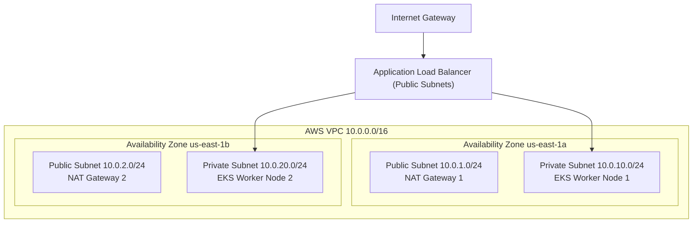

# DevOps & Systems Architecture Assignments

A repository of production-oriented architectural assignments, case-study problem statements, code challenges, and infrastructure design submissions.

---

## 📌 Assignments Overview

| Assignment | Topic & Domain | Architectural Pattern | Deliverable |
| :--- | :--- | :--- | :--- |
| **[Assignment 01](./assignment-01-high-availability-vpc/)** | Resilient Multi-AZ VPC | High Availability Network Design | Terraform IaC + CIDR calculation |
| **[Assignment 02](./assignment-02-zero-downtime-k8s-rollout/)** | Zero-Downtime Rollouts | Kubernetes Blue/Green & Canary | K8s Manifests + Envoy Ingress |
| **[Assignment 03](./assignment-03-secure-ci-cd-pipeline/)** | Supply Chain Security | DevSecOps & Image Signing | GitHub Actions + Trivy + Cosign |
| **[Assignment 04](./assignment-04-observability-prometheus-grafana/)** | SRE & Observability | RED Method Telemetry | Prometheus Rules + Grafana JSON |

---

## 🏗️ Assignment 01: High-Availability VPC Architecture

---

## 👤 Author

**Emaan Humayun**
- GitHub: [@EmaanHumayun](https://github.com/EmaanHumayun)
- LinkedIn: [Emaan Humayun](https://linkedin.com/in/www.linkedin.com/in/emaanmuhammadhumayun)
- Email: [emaanhumayun23072@gmail.com](mailto:emaanhumayun23072@gmail.com)
